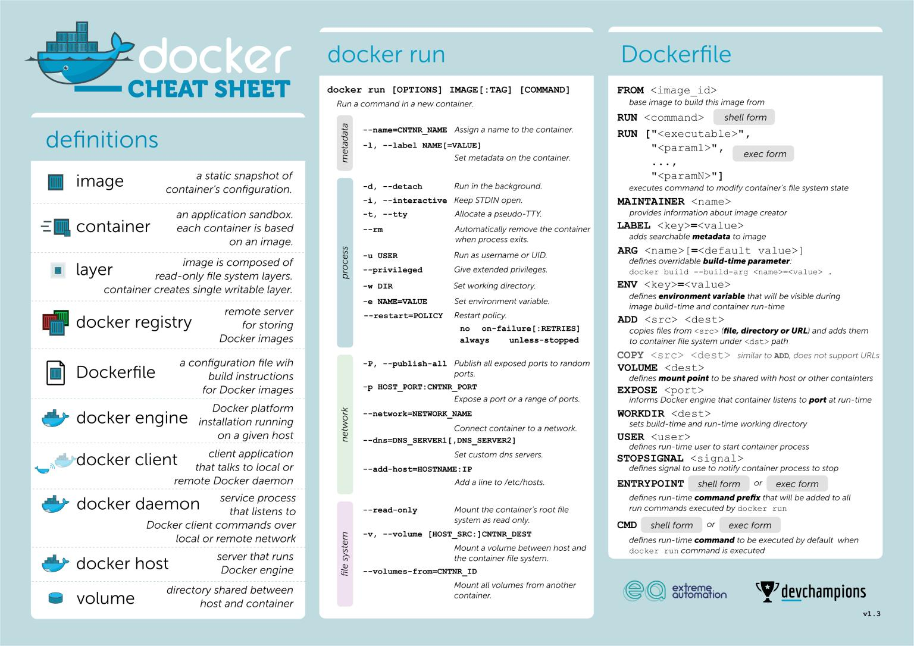
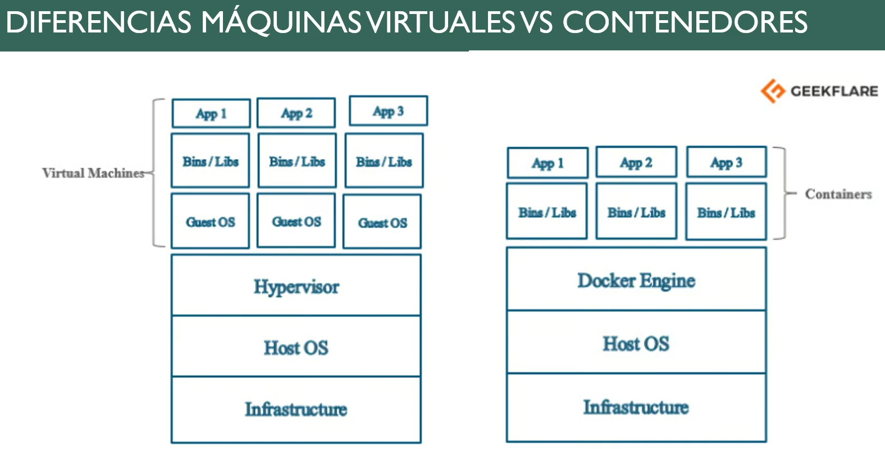
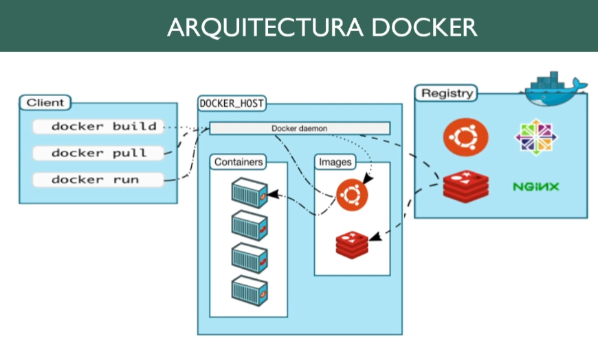

El propósito de esta actividad es comprender los conceptos fundamentales de Docker, su arquitectura, componentes y aplicaciones en entornos de desarrollo, así como adquirir habilidades prácticas básicas en el uso de contenedores. Se adjunta una hoja de consultas rápidas con el glosario, y comandos principales para la practica.

# Consignas de Investigación
Realizar una investigación y elaborar un documento breve (máximo 2 páginas) respondiendo los siguientes puntos:

1. Definir qué es un contenedor Docker y explicar sus diferencias con una máquina virtual.

2. Describir qué es Docker Desktop y explicar su arquitectura general.

3. Identificar los principales componentes de Docker Desktop (Docker Engine, CLI, Docker Compose, etc.).

4. Analizar las ventajas de utilizar contenedores Docker en entornos de desarrollo.

5. Explicar qué es una imagen Docker y cómo se construye.

6. Definir qué es Docker Hub y explicar su utilidad.

7. Comparar Docker, Kubernetes y Microservicios en Azure.

# Actividades Prácticas
1) Ejercicio: Descargar y ejecutar un contenedor de una aplicación web simple.

2) Ejercicio: Crear un contenedor que ejecute una aplicación simple.

3) Ejercicio: Inspeccionar y gestionar el contenedor (iniciar, detener, eliminar).

# Formato de Entrega
Documento en formato digital (PDF o Word). Máximo 2 páginas para la parte teórica. Incluir portada, desarrollo teórico y capturas de pantalla de las prácticas. Utilizar lenguaje técnico adecuado.

https://youtu.be/tcTPRuUBQ4g?si=H-DAEzyvILbEHYZQ 

https://youtu.be/Tf8oWijviqk?si=_-XOAP6IT6HOJGfl

