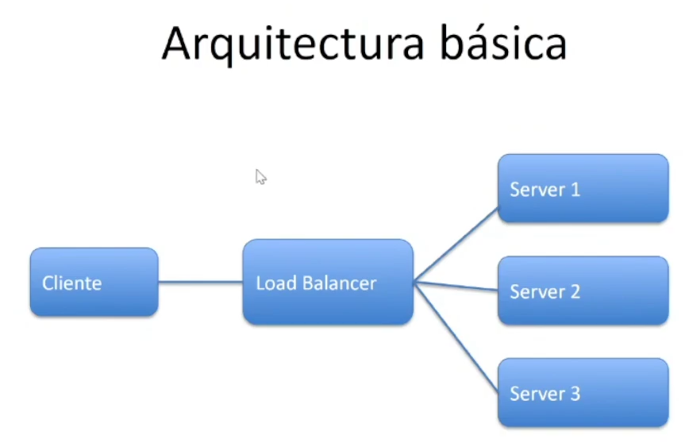

# Balanceadores

- distribuyen el trafico entre varios servidores para mejorar el rendimiento, disponibilidad y escalabilidad de los servicios web
- permiten evitar sobrecargar y asegurar que las apps sigan funcoinando incluso si un servidor falla

# ojbetivos del balanceo de carga
- repartir solicitudes entre los serv disponibles
- aumentar la capacidad y disponibilidad dels ervicio
- reducir tiempos de rta
- mejorar tolerancia a fallas
- permitir mantenimiento sin interrumpcion del servicio

# tipos de balanceadores
distintos tipos segun la capa del modelo OSI en la que operan. ofrecen distintos controles sobre el tráfico
(esto es mas de redes)
- capa 3 (red)
- capa 4 (transporte)
- capa 7 (app) usuario

# capa 3 (red)
distribuyen trafico segun direcciones ip de origen y destino
- la idea es que pueda resolver la ruta mas corta hacia uno de los servidores que ofrece el servicio
- son rapidos y eficientes pero  no entienden el contenido de la solicitud

recitales, cancha, eventos, papa
enrutamiento simple en grandes volumenes de trafico

# capa 4 (transporte)
distribuyen trafico en funcion de dir IP y puertos TCP/UDP
- no analizan contenido, solo conexion
- ideales para apps que no necseitan inspección profunda

balancear peticions HTTP, HTTPS, bdd o entre varios serv
Nginx, aws network load balancer

# capa 7 (app)
operan en  nivel del contenido de las solicitudes HTTP/HTTPS
- permiten decisiones basadas en URLS, cookies, cabeceras o contenidos
- flexibles y + control

entre microservicios, redireccionamiento segun tipo de usuario o app
nginx

# métodos de distribucion del tráfico
pueden usar distintos algoritmos

- Round robin: las solicitudes se reparten de forma equitativa
- least connections: se envia al servidor con menos conexiones activas
- IP HASH: la ip del cliente determina que servidor atiende la solicitud
- weigthed: asigna ams trafico a serv con mayor capacidad

# beneficios 
- si un serv falla, se redirige a otro
- escalabilidad horizontal (añadir +serv)
- alta disponibilidad y resiliencia
- optimizacion de recursos
- experiencia + fluida
- menor riesgo

# El modelo OSI
divide el funcionamiento de las redes en 7 capas.

cada una cumple una funcion especifica y trabaja con las demas para permitir la comunicacion entre dispositivo

comprender estas capas ayuda a entender qen que nivel operan los balanceadores de carga y como optimizan el trafico de red

- es una herramienta conceptual que organiza funciones de la red en capas
- los balanceadores de carga aprovechan diferentes capas para distribuir el trafico de manera eficiente
- las 7 capas sirven para  diseñar redes eficientes
- capa 4 --> distribucion por IP y puertos
- capa 7 distribucion por contenido ya pps

# Capa 1 - Física
el medio de comuniacion, cable, fibra, wifi
conexion fisica, voltajes, topologia

# Capa 2 - enlace de datos
- es responsable de transferencia de datos, entre nodos adyacentes
- detecta y corrige errores básicos
- identifica disp mediante direcciones MAC (dir de la placa de red)
switches, tarjetas de red

# Capa 3 - red
define cómo se enrutan los datos a traves de diferentes redes
- usa dir IP para identificar disp
- acá operan los router
- los balanceadores  decarga en esta capa pueden distribuir trafico sgun ip y protocolos 
# Capa 4 - transporte
- garantiza entrega confiable de los datos TCP (ipv4 se amplió a ipv6) comunicacion sincronica. se negocia entre dispositivos, se habla con que velocidad se pueden transmitir esos datos y se transmite con una serie de pulsos, que van a ser paquetes. donde tiene la info sobre como esos pquetes van a llegar al otro lado. por eso la info que llega es la correcta. info critica
- o rápida sin confirmación UDP (streaming). es mas rapida, porque no espera confirmacion de que todo llego correctamente. info no critica
- divide los datos en segmentos y los ensambla en destino. reconstruye la señal con el paquete de datos para que llegue a destino correctgamente
- distribuyen  el trafico segun puertos ATCP/UDP
# Capa 5 - sesión
establece, mantiene y termina sesiones entre apps
- controla el dialogo entre disp
- autenticacion o reconexiones

# Capa 6 - presentacion
se encarga del formato y cifrado de datos
- traduce la info entre app y red
- compresion/codificaion de caracteres ssl/tls
# Capa 7 - app
interactua directamente con elusuario o apps finales
- http/s, dns, ftp, smtp